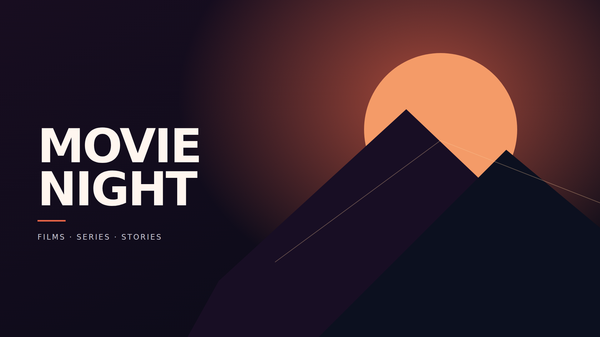
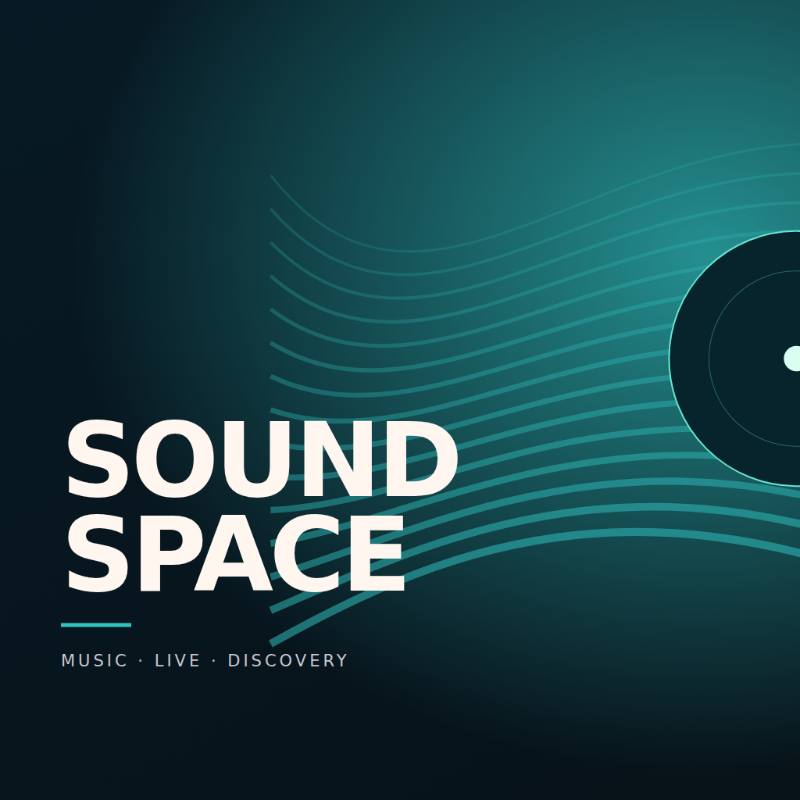

# Original complete-card examples

These six files demonstrate complete-image composition, independently designed
for Square and Rectangle. They contain no reproduced third-party logo, branded
font asset, photo or AI-recreated mark. The ordinary titles describe generic themes;
they do not identify or imply endorsement by a streaming/game brand.

| Theme | Square PNG / SVG | Rectangle PNG / SVG |
| --- | --- | --- |
| Cinema | [PNG](cinema-square.png) / [SVG](cinema-square.svg) | [PNG](cinema-rectangle.png) / [SVG](cinema-rectangle.svg) |
| Music | [PNG](music-square.png) / [SVG](music-square.svg) | [PNG](music-rectangle.png) / [SVG](music-rectangle.svg) |
| Games | [PNG](games-square.png) / [SVG](games-square.svg) | [PNG](games-rectangle.png) / [SVG](games-rectangle.svg) |

Original source and exported PNGs are contributed under the repository's
[MIT notice](LICENSE.txt). Retain that notice on redistribution. No external font
file is shipped; SVGs use system sans-serif fallback. A file/hash/dimension register
is in `provenance.json`. These are category-art templates and preview/test inputs,
not a newly cleared branded asset collection. They are not included in the public
launcher WGT by default. Their visual acceptance is still pending.

For USB testing download a PNG, not an SVG. Import it for the desired installed app
through its action menu. Square masters are 1024×1024; landscape masters are
1920×1080. The TV importer downsamples landscape to at most 1280×720 without stretching.
